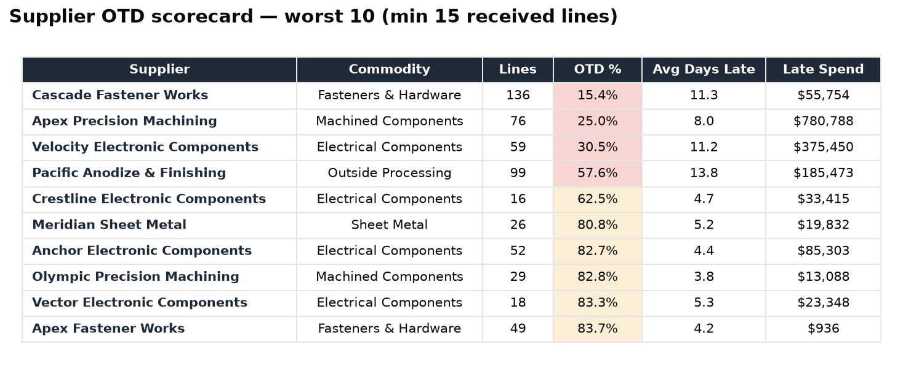
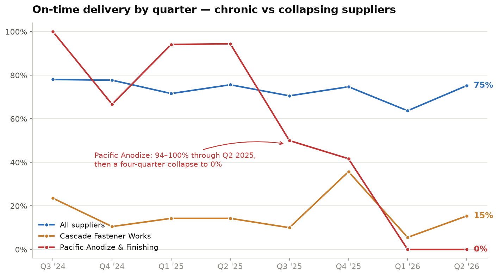
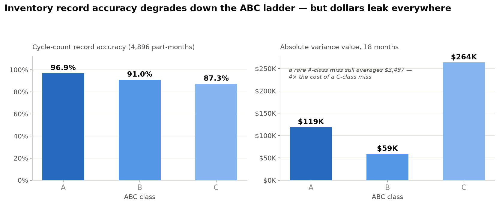
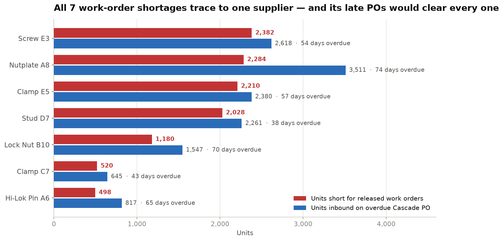
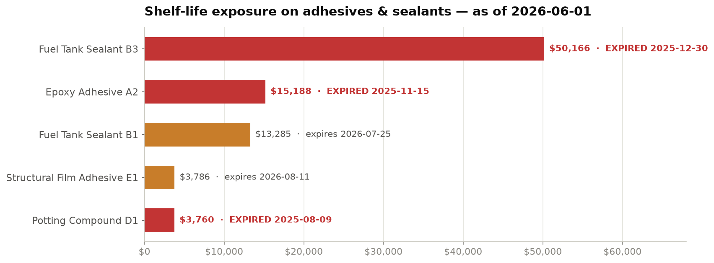

# AeroSupply Analytics — Supplier & Inventory Analysis for an AS9100 Aerospace Shop

End-to-end SQL portfolio project: a synthetic-but-realistic aerospace interiors manufacturer (PSU-100 Passenger Service Units, FAD-200 Fuel Access Doors) analyzed from raw CSVs to a findings memo, then put on a daily schedule.

The project runs in two steps. First, 14 SQL queries find the problems once and `FINDINGS.md` explains them. Then a small pipeline in [`pipeline/`](pipeline/) recomputes the supplier numbers every morning and refuses to publish a report built on bad data.

**Stack:** PostgreSQL · SQL (CTEs, window functions, multi-table joins) · Python (Polars, DuckDB, pytest)

## The four questions this project answers

1. **Which suppliers are hurting us, and is it getting worse?** → supplier OTD scorecard + quarterly trend with `LAG()`
2. **Can we trust our inventory records?** → cycle-count accuracy by ABC class (96.9% A-class vs 87.3% C-class)
3. **Can we actually build what's released?** → BOM explosion vs on-hand: 7 fastener shortages, all traced to one supplier's overdue POs
4. **Is it still true this morning?** → a daily pipeline that rebuilds the supplier scorecard, monthly OTD trend and delinquency aging from the same data, and logs PASS or FAIL

Full writeup with numbers: [`FINDINGS.md`](FINDINGS.md)

## Visuals

Each chart answers one specific question from the analysis (Q-numbers reference `sql/analysis_queries.sql`).

### Supplier OTD Scorecard


**Why this chart:** the first question any buyer asks is "who's late?" — but a raw OTD % alone can mislead. The scorecard (Q04) puts OTD next to volume, average days late, and dollars on late lines, so a 15% supplier with $56K of late spend and a 25% supplier with $781K read as two different problems. The 15-line minimum keeps small-sample suppliers from polluting the ranking.

### Chronic vs Collapsing Suppliers


**Why this chart:** a single OTD number hides direction. The quarterly trend (Q05, built with `LAG()`) separates the two failure modes that need different conversations: Cascade has been bad in every quarter for two years (a sourcing decision), while Pacific Anodize ran mostly 94–100% on time until mid-2025 and then collapsed to 0% (a "what changed at your site?" conversation). The all-supplier line is the baseline both are judged against.

### Cycle-Count Accuracy by ABC Class


**Why this chart:** two panels because there are two different problems, and averaging them hides both. The left panel (Q08) shows *frequency* — record accuracy degrades down the ABC ladder, exactly where count attention is lowest. The right panel (Q10) shows *severity* — C-class leaks the most total dollars through sheer miss volume, but a rare A-class miss costs 4× more per event. The fix is different for each, which is why recommendation 4 targets both ends.

### Shortage Root Cause — One Supplier, Seven Part Numbers


**Why this chart:** the BOM explosion (Q12) found 7 parts short for released work orders — this chart proves it's really *one* problem. Pairing each shortage (red) with the units already inbound on an overdue Cascade PO (blue) shows the inbound quantity covers the shortfall in every case. No new buys needed; the fix is expediting one supplier, and the days-overdue labels say how urgent that is.

### Shelf-Life Exposure


**Why this chart:** in an AS9100 shop, expired sealant on the shelf is a quarantine-and-disposition action, not just a cost line. The chart (Q14) splits the exposure into material already past estimated expiry (red, labeled) versus lots inside the 90-day warning window (amber), sized by dollars at risk — which is what makes the $50K of fuel tank sealant the headline.

## Daily monitoring

The analysis answers the questions once. [`pipeline/`](pipeline/) keeps answering the supplier ones every day: it reads the same `data/` files, rebuilds the scorecard, the monthly OTD trend and delinquency aging with Polars and DuckDB, and writes them to Excel. Before writing anything it checks the input (file present, at least 500 rows, no blank supplier, promise date or PO number, every supplier known). If a check fails, it logs `FAIL` and exits with an error so Task Scheduler flags the run. Details: [`pipeline/README.md`](pipeline/README.md).

The tests in `tests/` make sure the two halves never drift apart: the pipeline's numbers must match the SQL (Q03 and Q04) on the same data.

There are two supplier scorecards on purpose. The daily one lists all 40 suppliers so buyers see everyone; the Q04 ranking in the analysis only includes suppliers with at least 15 lines, so small samples don't distort it.

## Repo structure

```
├── data/                     # six CSVs (generated)
│   ├── suppliers.csv             40 rows
│   ├── parts.csv                274 rows
│   ├── bom.csv                   64 rows
│   ├── purchase_order_lines.csv  ~1,500 rows
│   ├── inventory_snapshots.csv   4,896 rows (part × month, 18 months)
│   └── production_orders.csv     120 rows
├── sql/
│   ├── schema.sql            # DDL + \copy load + indexes
│   └── analysis_queries.sql  # 14 commented queries in 4 phases
├── pipeline/                 # daily OTD report: pipeline.py, sample outputs, run log
├── tests/                    # pytest: pipeline checks + pipeline-vs-SQL consistency
├── visuals/                  # the charts shown above
├── run_validation.py         # runs every query, writes validation_results.txt
├── validation_results.txt    # full output of all 14 queries
├── FINDINGS.md               # analyst memo: 3 findings + recommendations
└── requirements.txt          # Python packages for the pipeline and tests
```

## Reproduce it

```bash
createdb aerosupply
cd data && psql -d aerosupply -f ../sql/schema.sql   # loads all six tables
psql -d aerosupply -f ../sql/analysis_queries.sql    # runs the analysis
```

Or without a database, using DuckDB:

```bash
pip install -r requirements.txt
python run_validation.py        # runs all 14 queries, writes validation_results.txt
python -m pytest                # pipeline checks + pipeline-vs-SQL consistency
python pipeline/pipeline.py     # today's OTD report into pipeline/output/
```

## Why synthetic data

Real AS9100 shop data is ITAR/proprietary and can't leave the building. The data models real patterns from aerospace floor experience — serialized parts, shelf-life-controlled sealants, conditional supplier approvals, work-order-driven demand — and has discoverable problems built in so the SQL has something true to find. Every number in the findings is the output of a query in `analysis_queries.sql`, not an assumption.
